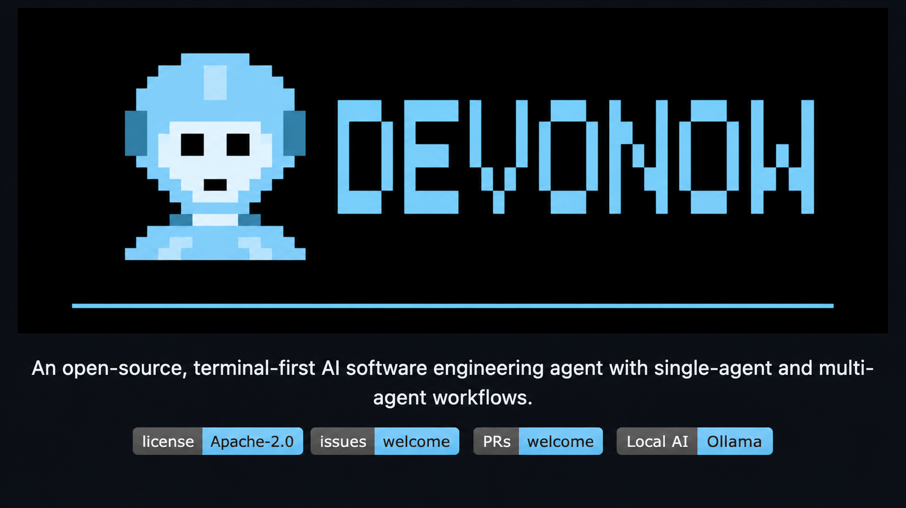

<h1 align="center"></h1>

DevoNow CLI works inside your local project, can edit and run code, and supports single-agent and multi-agent workflows. It is designed for developers who want a configurable agent experience that can use different model providers and specialized agent teams.

DevoNow CLI is derived from the open-source [Codex](https://github.com/openai/codex) codebase and has been independently customized with DevoNow branding, BYOAI provider support, and DevoNow's multi-agent workflows. It is not presented as an official OpenAI product; the original copyright and attribution notices are retained in [NOTICE](NOTICE).

## Highlights

- A branded terminal UI built for day-to-day development work
- Single-agent mode for focused tasks
- Manual multi-agent delegation with `@agent-name`
- Strategic multi-agent workflows with configurable routing and review loops
- Bring Your Own AI (BYOAI) with Claude, OpenAI, Azure OpenAI, Azure AI Foundry, compatible endpoints, or local Ollama and LM Studio models
- Configurable models, sandboxing, and approval policies
- MCP server support and non-interactive execution
- Open-source under the Apache License 2.0

## Requirements

- Git 2.23 or newer and [Rustup](https://rustup.rs/). The Rust workspace pins its compiler and components in [rust-toolchain.toml](devnow-rs/rust-toolchain.toml).
- A native build toolchain for your platform:
  - **macOS:** Install the Xcode Command Line Tools with `xcode-select --install` if needed.
  - **Ubuntu or Debian:** Run `sudo apt-get install build-essential pkg-config libcap-dev libssl-dev`.
  - **Windows:** Install Visual Studio Build Tools with the **Desktop development with C++** workload and a Windows SDK. Use the MSVC Rust toolchain.

## Install from source

Clone the repository and enter the Rust workspace.

```bash
git clone https://github.com/DEV0N0W/DevoNow-CLI.git
cd DevoNow-CLI/devnow-rs
```

Build the CLI with the versions recorded in the lockfile.

```bash
cargo build --locked --release -p codex-cli --bin codex
```

The workspace retains the internal `codex` binary name for upstream compatibility. The commands below install it as `devnow` and add it to your current shell's `PATH`.

**macOS or Linux**

```bash
mkdir -p "$HOME/.local/bin"
cp target/release/codex "$HOME/.local/bin/devnow"
chmod +x "$HOME/.local/bin/devnow"
export PATH="$HOME/.local/bin:$PATH"
devnow --version
```

**Windows PowerShell**

```powershell
$devoNowBin = "$env:LOCALAPPDATA\DevoNow\bin"
New-Item -ItemType Directory -Force $devoNowBin | Out-Null
Copy-Item .\target\release\codex.exe "$devoNowBin\devnow.exe"
$env:Path = "$devoNowBin;$env:Path"
devnow --version
```

For future terminals, add the installation directory to your shell startup file on macOS or Linux, or to your user `Path` environment variable on Windows.

## Configure DevoNow

Set `CODEX_HOME` in the terminal where you plan to run DevoNow. This gives DevoNow its own configuration directory. The variable name comes from the upstream codebase.

macOS or Linux:

```bash
export CODEX_HOME="$HOME/.devnow"
mkdir -p "$CODEX_HOME"
```

Windows PowerShell:

```powershell
$env:CODEX_HOME = "$HOME\.devnow"
New-Item -ItemType Directory -Force $env:CODEX_HOME | Out-Null
```

Create `$CODEX_HOME/config.toml`:

```toml
model = "YOUR_MODEL_NAME"
approval_policy = "on-request"
sandbox_mode = "workspace-write"
```

Provider credentials are read from environment variables and must not be committed to the repository. See [configuration](docs/config.md), [authentication](docs/authentication.md), and the [example configuration](docs/example-config.md) for provider-specific setup.

## Run

After configuring your model and signing in or setting the credentials your provider requires, open a project to explore.

```bash
cd /path/to/your/project
devnow
```

You can also supply an initial request:

```bash
devnow "explain this project and suggest the first improvement"
```

For non-interactive use:

```bash
devnow exec "review this change and report blocking issues"
```

## Operating modes

Use `/mode` in the terminal UI to select a workflow.

### Single AI

Runs one agent with the model and provider configured in `config.toml`.

### Multi-Agent

Lets you delegate directly to configured specialists:

```text
@developer implement the requested API and add focused tests
```

Start with [docs/agentic.sample.toml](docs/agentic.sample.toml).

### Multi-Agent Strategic

Runs an orchestrated workflow across planning, implementation, review, quality, execution, and final judgment roles. Start with [docs/multi-agent.sample.toml](docs/multi-agent.sample.toml).

## Documentation

- [Getting started](docs/getting-started.md)
- [Installation](docs/install.md)
- [Configuration](docs/config.md)
- [Authentication](docs/authentication.md)
- [Sandbox modes](docs/sandbox.md)
- [Execution policies](docs/execpolicy.md)
- [Slash commands](docs/slash_commands.md)
- [Agent instructions](docs/agents_md.md)

## Contributing

Issues and pull requests are welcome. Please read the [contribution guide](docs/contributing.md), including its [local Rust checks](docs/contributing.md#local-rust-checks), and review the [Code of Conduct](CODE_OF_CONDUCT.md) and [support guide](SUPPORT.md) before participating.

## License and attribution

DevoNow CLI is licensed under the [Apache License 2.0](LICENSE). It is derived from the open-source [OpenAI Codex](https://github.com/openai/codex) codebase and is not an official OpenAI product. Required copyright, license, and third-party attribution notices are retained in [NOTICE](NOTICE).
